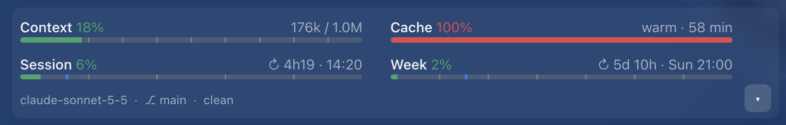

# Usage Band

A Claude Code mod that adds a compact band above the prompt showing how much room you have left:



Collapsed, it shrinks to a single row:


| Meter | What it shows |
|---|---|
| **Context** | Context window fill, tokens used / window size |
| **Cache** | Prompt-cache hit rate of the last turn, and whether the cache is still warm (time left) |
| **Session** | 5-hour rate-limit window: % used, time to reset, reset clock time |
| **Week** | 7-day rate-limit window: % used, time to reset, reset day and time |

Under the meters (or at the left of the single row when collapsed) a colored info line shows the current **model**, the **git branch** of the session's folder and the **changed lines** against `HEAD`: light-green `+added`, light-red `-removed` (staged and unstaged; `clean` when nothing changed, `N untracked` for new files only, `no git` outside a repository). It refreshes after each turn and once a minute.

Usage bars turn yellow at 70% and red at 90%; the Cache bar is the other way round (high hit rate is green, below 40% red). On the Session and Week bars a blue marker (taller than the bar, with a dark halo) shows how much of the window's *time* has passed — if the fill is left of the marker, you are using it slower than the clock.

The **▾ / ▴** button on the right collapses the band to a single row of four small bars (`Ctx`, `Cache`, `5h`, `Wk`) and back.

Works in the Claude Code desktop app (SVG bars) and in the terminal (text bars `████░░░┃░░` sized to the window width, with the blue `┃` marking elapsed time). Tested on both surfaces: `claude plugin test .`.

## Install

At the prompt of a terminal Claude Code session:

```
/plugin install usage-band --marketplace 1inq/usage-band
```

From a shell:

```bash
claude plugin install usage-band --marketplace 1inq/usage-band
```

In the desktop app, where `/plugin` does not run: click **+** next to the prompt box, then **Plugins**, **Add marketplace** with `1inq/usage-band`, then **Add plugin**.

Answer `y` to add the marketplace, then pick a scope (user scope loads it in every session).

## Update

Updates are delivered by version: each release bumps `version` in `.claude-plugin/plugin.json`, and Claude picks it up from this repository.

- **Terminal session:** `/plugin` → **Marketplaces** → `usage-band` → update (or toggle auto-update there), then restart the session.
- **Desktop app:** **+** next to the prompt box → **Plugins** → update `usage-band`.
- **Shell:**

```bash
claude plugin marketplace update usage-band
claude plugin update usage-band
```

A restart applies the new version.

## Notes

- Rate limits (Session / Week) are reported only on a Claude subscription, and only after the first response of a session. Until then the band shows `no data`.
- The cache "warm" countdown assumes a 1-hour cache TTL from the last response. Change `CACHE_TTL` in `hooks/register.tsx` if your setup uses the 5-minute TTL.
- There is no daily limit in the API, so there is no "day" meter.

## Development

```bash
claude --plugin-dir /path/to/usage-band
claude plugin validate /path/to/usage-band
```

## License

MIT
